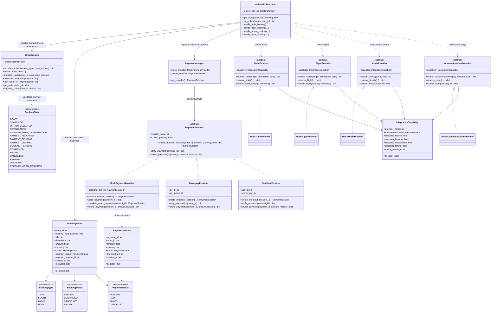
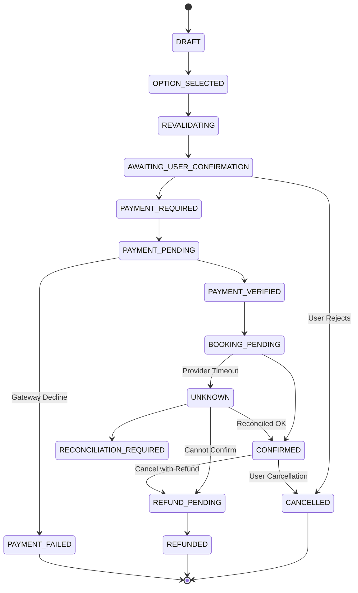

GIVE# F.R.I.D.A.Y. Architecture Reference

> **Guiding Principle:** EXTEND, DON'T REPLACE. PRESERVE, THEN IMPROVE.  
> F.R.I.D.A.Y. V3 introduces a transactional action subsystem while maintaining zero breaking changes to the four-process execution baseline.

---

## 1. System Overview & The Four-Process Model

F.R.I.D.A.Y. operates as four cooperating, decoupled processes:

```text
┌────────────────────────────────────────────────────────┐
│                   React 19 Frontend                    │
│             (Vite + TailwindCSS + LiveKit)             │
│               http://localhost:5173                    │
└───────────────────────────┬────────────────────────────┘
                            │ WebRTC Audio / REST API
┌───────────────────────────┴────────────────────────────┐
│                  Token & API Server                    │
│                 (FastAPI on Port 8080)                 │
│         Auth JWTs, Health Checks, Action REST API      │
└───────────────────────────┬────────────────────────────┘
                            │ REST / WebSocket
┌───────────────────────────┴────────────────────────────┐
│                   LiveKit Cloud / Local                │
│                 (WebRTC Media Gateway)                 │
└───────────────────────────┬────────────────────────────┘
                            │ WebRTC Audio Pipe
┌───────────────────────────┴────────────────────────────┐
│                    Voice Agent Worker                  │
│       (LiveKit Agents + Sarvam STT/TTS + Groq LLM)     │
└───────────────────────────┬────────────────────────────┘
                            │ SSE (Server-Sent Events)
┌───────────────────────────┴────────────────────────────┐
│                   FastMCP Tool Server                  │
│                 (FastMCP on Port 8000)                 │
│             All 30 System, Web, & Action Tools         │
└────────────────────────────────────────────────────────┘
```

### Process Definitions

1. **MCP Server** (`uv run friday` or `python server.py`):
   - FastMCP server listening on `http://127.0.0.1:8000/sse`.
   - Exposes 30 tools spanning system diagnostics, memory, tasks, web search, and transactional actions (trains, flights, movies, hotels, cancellations).

2. **Voice Agent** (`uv run friday_voice` or `uv run agent_friday.py dev`):
   - Connects to LiveKit Cloud WebRTC room.
   - Manages voice pipeline: Silero VAD → Sarvam Saaras v3 STT → Groq Llama 3.3 70B LLM → Sarvam Bulbul v3 TTS.
   - Connects to FastMCP server via SSE client to execute functions requested by the LLM.

3. **Token & REST Server** (`python token_server.py`):
   - FastAPI server listening on `http://0.0.0.0:8080`.
   - Serves LiveKit auth tokens (`/api/token`), system health metrics (`/health`, `/metrics`).
   - Serves Versioned Action APIs (`/api/v1/bookings`, `/api/v1/payments`, webhooks, checkout).

4. **React Frontend** (`cd frontend && npm run dev`):
   - Vite + React + Lucide Icons on `http://localhost:5173`.
   - Connects to LiveKit room for live voice interaction.
   - Displays real-time audio visualization, system diagnostics, and the Orders Mission Control panel.

---

## 2. Core Booking Class Diagram

The diagram below shows the main booking and payment classes, their important fields, and their relationships. It is oriented top-to-bottom for a vertical layout.



## 3. Universal Order Lifecycle & Finite State Machine

All bookings (trains, flights, movies, accommodations) follow a unified 15-state lifecycle enforced by `friday.actions.state_machine.OrderStateMachine`:



### Invariants:
1. Direct transitions jumping over intermediate states (e.g., `DRAFT` directly to `CONFIRMED`) are strictly forbidden and throw `StateTransitionError`.
2. Tax and surcharge calculations are strictly performed server-side (18% GST on services).
3. Every order is assigned a unique reference ID prefixed with its type and demo status (e.g. `DEMO-TRAIN-B792A1`).

---

## 4. Directory Layout

```text
friday/
├── actions/                  # Transactional domain & providers
│   ├── interfaces.py         # Abstract provider interfaces & capabilities
│   ├── state_machine.py      # Strict 15-state order state machine
│   ├── order_service.py      # Universal order lifecycle manager
│   ├── confirmations.py      # Cryptographic SHA-256 confirmation engine
│   ├── payment_service.py    # PCI-isolated out-of-band payment gateway
│   ├── webhook.py            # HMAC-SHA256 verified payment webhooks
│   ├── reconciliation.py     # Network failure recovery & status audit
│   ├── idempotency.py        # Request deduplication engine
│   ├── cancellation.py       # Cancellation policies & refund calculation
│   ├── notifications.py      # Multi-channel notification dispatch
│   ├── railway_safety.py     # Indian Railway legal compliance validator
│   ├── trains.py             # Train search and booking provider (Demo)
│   ├── flights.py            # Flight search and booking provider (Demo)
│   ├── movies.py             # Movie search and booking provider (Demo)
│   └── hotels.py             # Hotel search and booking provider (Demo)
├── core/
│   ├── auth.py               # Bearer token auth & scoped permissions
│   ├── sanitizer.py          # Prompt-injection defense & input safety
│   ├── memory_repo.py        # Supabase/Local JSON memory storage
│   ├── task_repo.py          # Supabase/Local JSON task storage
│   └── ...
├── tools/                    # FastMCP tool registrations
│   ├── booking.py            # Search, book, and cancel action tools
│   ├── diagnostics.py        # Health and metrics tools
│   ├── memory.py             # Cognitive memory tools
│   ├── tasks.py              # Stark task management tools
│   ├── web.py                # Web search & news scraping
│   └── system.py             # System info & time tools
└── config/
    └── settings.py           # Feature flags and environment configuration
```
