# F.R.I.D.A.Y. Project Diagrams

These diagrams cover the assistant's configured voice/chat, MCP tools,
configuration, memory, task, and provider components.

## Project Class Diagram

```mermaid
classDiagram
    direction TB

    class FridayAgent {
        <<runtime component>>
        +SYSTEM_PROMPT: str
        +entrypoint(ctx)
        +on_enter()
    }

    class ProviderManager {
        <<provider factory>>
        +get_stt()
        +get_llm()
        +get_vision_llm()
        +get_tts()
    }

    class FridayConfig {
        +env: EnvironmentConfig
        +server: ServerConfig
        +livekit: LiveKitConfig
        +providers: ProviderConfig
        +database: DatabaseConfig
        +security: SecurityConfig
        +resilience: ResilienceConfig
        +features: FeatureFlags
        +content: ContentConfig
        +memory: MemoryConfig
        +validate()
    }

    class EnvironmentConfig {
        +APP_ENV: str
        +DEBUG: bool
        +LOG_LEVEL: str
        +is_production: bool
        +is_development: bool
        +is_testing: bool
    }

    class ServerConfig {
        +SERVER_NAME: str
        +MCP_SERVER_HOST: str
        +MCP_SERVER_PORT: int
        +MCP_TRANSPORT: str
        +TOKEN_SERVER_HOST: str
        +TOKEN_SERVER_PORT: int
        +mcp_server_url: str
    }

    class LiveKitConfig {
        +URL: str
        +API_KEY: str
        +API_SECRET: str
        +DEFAULT_ROOM: str
        +TOKEN_EXPIRY_SECONDS: int
        +is_configured: bool
    }

    class ProviderConfig {
        +PRIMARY_STT: str
        +FALLBACK_STT: str
        +PRIMARY_LLM: str
        +FALLBACK_LLM: str
        +PRIMARY_TTS: str
        +FALLBACK_TTS: str
        +SARVAM_API_KEY: str
        +GROQ_API_KEY: str
        +GOOGLE_API_KEY: str
        +OPENAI_API_KEY: str
    }

    class DatabaseConfig {
        +SUPABASE_URL: str
        +SUPABASE_API_KEY: str
        +SUPABASE_SERVICE_KEY: str
        +is_configured: bool
    }

    class SecurityConfig {
        +ALLOWED_ORIGINS: list[str]
        +AUTH_SECRET: str
        +RATE_LIMIT_REQUESTS: int
        +RATE_LIMIT_WINDOW_SECONDS: int
        +MAX_ROOM_NAME_LENGTH: int
        +MAX_IDENTITY_LENGTH: int
    }

    class FeatureFlags {
        +ENABLE_WEB_SEARCH: bool
        +ENABLE_MEMORY: bool
        +ENABLE_TASKS: bool
        +ENABLE_DATABASE: bool
        +ENABLE_WORLD_MONITOR: bool
        +ENABLE_PROVIDER_FAILOVER: bool
        +ENABLE_AUTH: bool
        +ENABLE_RATE_LIMITING: bool
        +ENABLE_HEALTH_CHECKS: bool
        +ENABLE_METRICS: bool
    }

    class ResilienceConfig {
        +HTTP_CONNECT_TIMEOUT: float
        +HTTP_READ_TIMEOUT: float
        +HTTP_TOTAL_TIMEOUT: float
        +MAX_RETRIES: int
        +MCP_SESSION_TIMEOUT: int
        +MAX_TOOL_CALLS_PER_TURN: int
    }

    class ContentConfig {
        +NEWS_FEEDS: list[str]
        +NEWS_ITEMS_PER_FEED: int
        +NEWS_MAX_ARTICLES: int
    }

    class MemoryConfig {
        +CONTEXT_WINDOW_SIZE: int
        +MAX_LONG_TERM_MEMORIES: int
        +MEMORY_RETRIEVAL_LIMIT: int
    }

    class FastMCPServer {
        <<runtime component>>
        +name: str
        +register_tools()
        +register_prompts()
        +register_resources()
        +run(transport)
    }

    class ToolGroups {
        <<modules>>
        +web
        +system
        +utils
        +memory
        +tasks
        +diagnostics
    }

    class MemoryService {
        -_working_memory: deque
        +add_working_context(role, content)
        +get_working_context()
        +clear_working_context()
        +remember(key, value, category, tags)
        +recall(query, category)
        +forget(key)
    }

    class MemoryRepository {
        -_in_memory: dict
        +save_memory(key, value, category, user_id, tags)
        +get_memory(key, user_id)
        +list_memories(category, query, user_id, limit)
        +delete_memory(key, user_id)
        +clear_all(user_id)
    }

    class TaskRepository {
        -_in_memory: dict
        -_counter: int
        +create_task(title, description, priority, due_date, user_id)
        +get_task(task_id)
        +list_tasks(status, user_id, limit)
        +update_task(task_id, title, description, status, priority)
        +delete_task(task_id)
    }

    class MemoryRecord {
        <<dictionary record>>
        +id: str
        +user_id: str
        +key: str
        +value: str
        +category: str
        +tags: list[str]
        +created_at: str
        +updated_at: str
    }

    class TaskRecord {
        <<dictionary record>>
        +id: str
        +user_id: str
        +title: str
        +description: str
        +status: str
        +priority: str
        +due_date: Optional[str]
        +created_at: str
        +updated_at: str
    }

    class WebSearchService {
        <<service>>
        +search_web(query)
    }

    class TokenHealthServer {
        <<runtime component>>
        +GET /api/config
        +GET /api/token
        +GET /health
        +GET /health/ready
        +GET /metrics
    }

    class ReactFrontend {
        <<runtime component>>
        +connect to LiveKit
        +send chat messages
        +fetch public configuration
    }

    FridayAgent ..> ProviderManager : obtains speech and language providers
    FridayAgent ..> FastMCPServer : connects over HTTP SSE
    FridayAgent ..> LiveKitConfig : joins configured room
    ProviderManager ..> ProviderConfig : selects configured providers

    FridayConfig *-- EnvironmentConfig
    FridayConfig *-- ServerConfig
    FridayConfig *-- LiveKitConfig
    FridayConfig *-- ProviderConfig
    FridayConfig *-- DatabaseConfig
    FridayConfig *-- SecurityConfig
    FridayConfig *-- FeatureFlags
    FridayConfig *-- ResilienceConfig
    FridayConfig *-- ContentConfig
    FridayConfig *-- MemoryConfig

    FastMCPServer o-- ToolGroups : registers
    ToolGroups ..> MemoryService : memory tools
    ToolGroups ..> MemoryRepository : conversation and memory tools
    ToolGroups ..> TaskRepository : task tools
    ToolGroups ..> WebSearchService : web tools
    MemoryService --> MemoryRepository : long-term storage
    MemoryService ..> MemoryRecord : reads and writes
    TaskRepository ..> TaskRecord : reads and writes
    MemoryRepository ..> DatabaseConfig : optional Supabase
    TaskRepository ..> DatabaseConfig : optional Supabase

    ReactFrontend ..> TokenHealthServer : REST API
    ReactFrontend ..> LiveKitConfig : LiveKit connection settings
```



`MemoryRecord` and `TaskRecord` represent the dictionaries returned and stored
by their repositories; they are not Python dataclasses. Memory and task
repositories use local JSON-backed storage and can use Supabase when database
support is enabled and configured.

## Project-Wide Runtime Sequence

This sequence shows how the services start, how the frontend establishes an
assistant session, and how voice, chat, images, tools, storage, and diagnostics
interact. The launcher starts the API and MCP servers; the frontend and LiveKit
agent worker are separate processes.

```mermaid
sequenceDiagram
    autonumber
    actor Operator
    actor User
    participant Launcher as main.py
    participant Frontend as React Frontend
    participant API as Token and Health API
    participant Auth as LocalAuthStore (SQLite)
    participant LiveKit as LiveKit Room
    participant Agent as FridayAgent Worker
    participant Providers as ProviderManager
    participant STT as Speech Recognition
    participant LLM as Configured LLM / Vision Model
    participant MCP as FastMCP Server (HTTP/SSE)
    participant Tools as MCP Tool Groups
    participant Services as Memory / Web Services
    participant Repositories as Memory / Task Repositories
    participant Data as Supabase or local storage
    participant Web as External Web Sources

    rect rgb(235, 245, 255)
        Note over Operator,MCP: Start the project services
        Operator->>Launcher: Run main.py
        Launcher->>Launcher: Validate config and run health audit
        par API process
            Launcher->>API: Start aiohttp server
            API-->>Launcher: Listening on configured API port
        and MCP process
            Launcher->>MCP: Start FastMCP over SSE
            MCP->>Tools: Register web, system, utility, memory, task, diagnostic tools
            MCP->>MCP: Register prompts and resources
            MCP-->>Launcher: Listening on configured MCP port
        end
        Operator->>Frontend: Start Vite frontend separately
        Operator->>Agent: Start LiveKit agent worker separately
    end

    rect rgb(242, 250, 242)
        Note over User,LiveKit: Optional account access, then room connection
        opt Email sign-in or sign-up
            User->>Frontend: Enter email and request verification code
            Frontend->>API: POST /api/auth/otp
            API->>Auth: Save OTP challenge
            API-->>Frontend: Code delivery result
            User->>Frontend: Submit verification code
            Frontend->>API: POST /api/auth/verify
            API->>Auth: Verify code and issue local session
            Auth-->>API: Access token, refresh token, user
            API-->>Frontend: Local application session
        end
        opt Google sign-in
            Frontend->>API: GET /api/config for public sign-in settings
            API-->>Frontend: Public Supabase URL and anon key
            Frontend->>Frontend: Complete Supabase OAuth redirect
            Frontend->>API: POST /api/auth/google with provider access token
            API->>Web: Validate provider token with Supabase Auth
            Web-->>API: Verified user profile
            API->>Auth: Create local application session
            Auth-->>API: Local access and refresh tokens
            API-->>Frontend: Local application session
        end
        Frontend->>API: GET /api/token (optional bearer token)
        opt Authenticated connection
            API->>Auth: Validate local access token
            Auth-->>API: Authenticated user identity
        end
        API->>API: Sanitize room and identity; mint LiveKit JWT
        API-->>Frontend: LiveKit URL, JWT, room, identity
        Frontend->>LiveKit: Connect to room with JWT
        Agent->>Providers: Select STT, LLM, and TTS providers
        Providers-->>Agent: Configured providers and fallbacks
        Agent->>MCP: Connect tool client over HTTP/SSE
        Agent->>LiveKit: Join room and start AgentSession
        LiveKit-->>Frontend: Connected assistant session
    end

    rect rgb(255, 249, 235)
        Note over User,LLM: User request and assistant reasoning
        alt Voice request
            User->>LiveKit: Speak into microphone
            LiveKit->>Agent: Audio frames
            Agent->>STT: Transcribe audio
            STT-->>Agent: Recognized words
        else Typed message
            User->>Frontend: Send chat text
            Frontend->>LiveKit: Publish lk.chat text stream
            LiveKit->>Agent: Text stream
        end
        Agent->>LLM: Interpret request with FRIDAY system instructions
        LLM-->>Agent: Answer directly or request an MCP tool

        opt User attaches an image to a typed chat message
            Frontend->>Frontend: Resize photo and send as LiveKit attachment
            LiveKit->>Agent: lk.chat attachment byte stream
            Agent->>Providers: Select vision-capable model
            Providers-->>Agent: Vision model
            Agent->>LLM: Analyze image content
            LLM-->>Agent: Image description
            Agent->>LLM: Combine image description with user's question
        end
    end

    rect rgb(248, 240, 255)
        Note over Agent,Web: MCP tool execution when the model requests a tool
        opt Tool call requested
            Agent->>MCP: Invoke selected tool over HTTP/SSE
            MCP->>Tools: Dispatch tool request
            alt Memory operation
                Tools->>Services: remember, recall, or forget
                Services->>Repositories: Read or change long-term memory
                alt Database enabled and configured
                    Repositories->>Data: Read or change memory in Supabase
                    opt Supabase operation fails
                        Repositories->>Data: Fall back to local JSON-backed store
                    end
                else Database unavailable or unconfigured
                    Repositories->>Data: Read or write local JSON-backed store
                end
                Data-->>Repositories: Memory result
                Repositories-->>Services: Memory records
                Services-->>Tools: Formatted memory result
            else Task operation
                Tools->>Repositories: Create, list, update, complete, or delete task
                alt Database enabled and configured
                    Repositories->>Data: Read or change tasks in Supabase
                    opt Supabase operation fails
                        Repositories->>Data: Fall back to local JSON-backed store
                    end
                else Database unavailable or unconfigured
                    Repositories->>Data: Read or write local JSON-backed store
                end
                Data-->>Repositories: Task result
                Repositories-->>Tools: Task record(s)
            else Web or news request
                Tools->>Services: Search web, fetch URL, or load news feeds
                Services->>Web: Request search results or RSS/page content
                Web-->>Services: External content
                Services-->>Tools: Formatted web or news results
            else System or diagnostic request
                Tools->>Tools: Read system details, health, or metrics
            end
            Tools-->>MCP: Tool result
            MCP-->>Agent: Tool result over HTTP/SSE
            Agent->>LLM: Generate final response using result
            LLM-->>Agent: Final response text
        end
    end

    rect rgb(240, 248, 248)
        Note over Agent,Data: Deliver response and retain applicable history
        alt Voice response
            Agent->>Providers: Synthesize response
            Providers-->>Agent: Speech audio
            Agent->>LiveKit: Publish audio and transcript
            LiveKit-->>User: Play spoken response
        else Typed response
            Agent->>LiveKit: Publish chat response
            LiveKit-->>Frontend: Assistant message
            Frontend-->>User: Render response
        end
        Frontend->>Frontend: Save conversations and photo blobs in browser storage
        opt Authenticated conversation sync
            Frontend->>API: PUT /api/conversations/{conversation_id}
            API->>Auth: Validate access token and save conversation in SQLite
            Auth-->>API: Save result
            API-->>Frontend: Sync response
        end
    end

    opt Health or metrics requested
        Frontend->>API: GET /health, /health/ready, or /metrics
        API-->>Frontend: Health status or metrics summary
    end
```

## Related source files

- [Voice agent](./agent_friday.py)
- [Provider selection](./friday/providers/manager.py)
- [Project settings](./friday/config/settings.py)
- [MCP server](./server.py)
- [Tool registry](./friday/tools/__init__.py)
- [Memory service](./friday/services/memory.py)
- [Memory repository](./friday/repositories/memory.py)
- [Task repository](./friday/repositories/task.py)
- [Task tools](./friday/tools/tasks.py)
- [Token and health server](./token_server.py)
