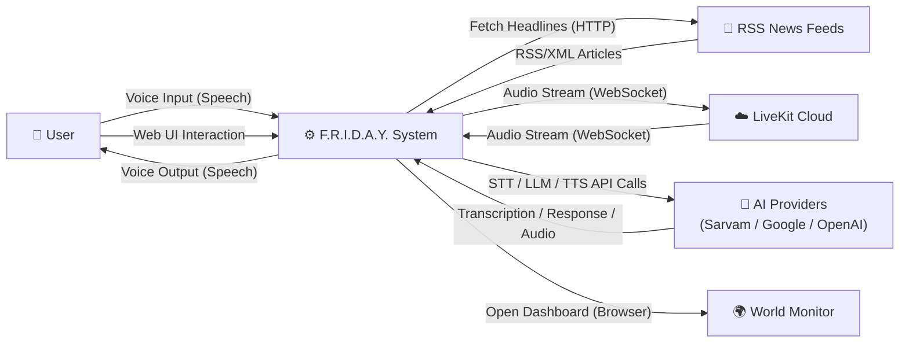
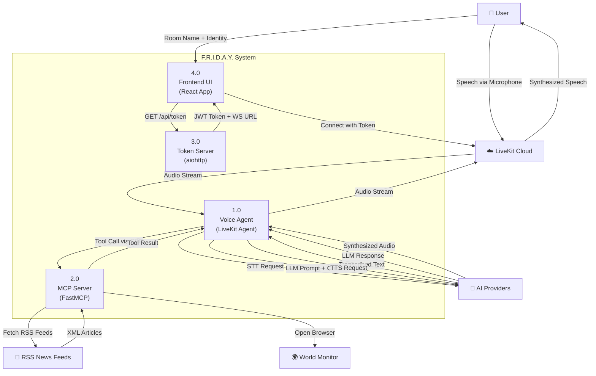
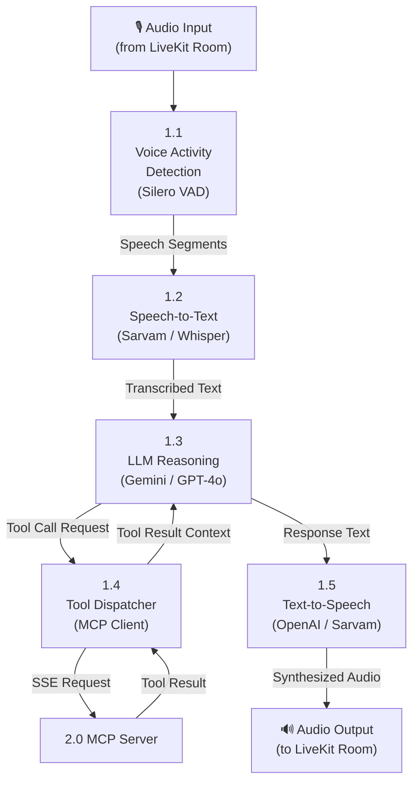
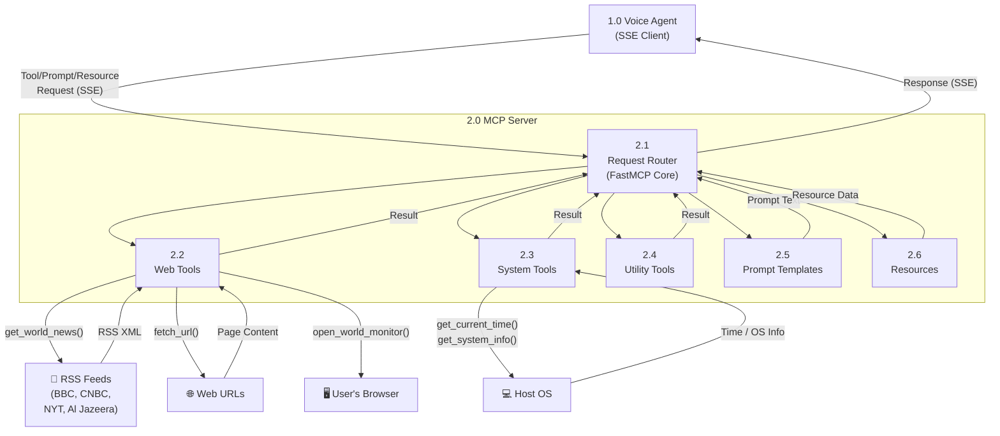
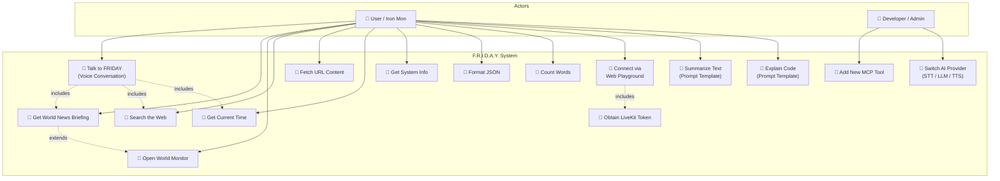

# F.R.I.D.A.Y. — Project Documentation

> *Fully Responsive Intelligent Digital Assistant for You*

---

## 1.1 Problem Definition (Identification of Needs)

### Problem Statement

Traditional AI assistants (e.g., Siri, Alexa, Google Assistant) are constrained to vendor-locked ecosystems, offer limited extensibility, and lack the ability to integrate custom back-end tools in real time. Users who need a **highly customizable, voice-controlled AI assistant** — one that can fetch live news, search the web, query system status, and open external dashboards on command — have no plug-and-play open-source solution that combines:

1. **Real-time voice interaction** (Speech-to-Text → LLM reasoning → Text-to-Speech) in a low-latency pipeline.
2. **Extensible tool ecosystem** — where developers can add arbitrary back-end capabilities (APIs, scripts, system commands) and have the LLM invoke them dynamically.
3. **Provider flexibility** — the ability to swap STT, LLM, and TTS providers (Google Gemini, OpenAI, Sarvam, Deepgram, etc.) without rewriting the core application.
4. **Multilingual support** — understanding and responding in multiple Indian languages while maintaining a consistent persona.

### Identified Needs

| # | Need | Description |
|---|------|-------------|
| 1 | **Voice-first interaction** | A hands-free, conversational assistant that listens via microphone and responds with natural speech. |
| 2 | **Live information retrieval** | Ability to fetch real-time global news headlines from multiple RSS feeds (BBC, CNBC, NYT, Al Jazeera). |
| 3 | **Web search & URL fetching** | On-demand web search and raw page content retrieval for arbitrary queries. |
| 4 | **System introspection** | Report current date/time, OS details, Python version, and machine architecture. |
| 5 | **Visual dashboard launch** | Open a live world-monitor dashboard in the user's browser for visual situational awareness. |
| 6 | **Modular tool extensibility** | A plug-in architecture where new tools can be added by simply creating a Python file and registering it — no core code changes needed. |
| 7 | **Provider-agnostic AI pipeline** | Swap STT (Sarvam / Whisper), LLM (Gemini / OpenAI), and TTS (OpenAI / Sarvam) providers via a single config change. |
| 8 | **Web-based playground UI** | A React front-end for connecting to the voice assistant, visualizing audio state, and discovering available commands. |

---

## 1.2 Requirement Specifications (Product/System Tasks)

### Functional Requirements

| ID | Requirement | Priority | Component |
|----|-------------|----------|-----------|
| FR-01 | The system shall convert user speech to text in real time using configurable STT providers (Sarvam Saaras v3 or OpenAI Whisper). | High | Voice Agent |
| FR-02 | The system shall process transcribed text through an LLM (Google Gemini 2.5 Flash or OpenAI GPT-4o) to generate intelligent responses. | High | Voice Agent |
| FR-03 | The system shall synthesize LLM responses into natural speech using configurable TTS providers (OpenAI TTS `nova` voice or Sarvam Bulbul v3). | High | Voice Agent |
| FR-04 | The system shall fetch live global news headlines from 4 RSS feeds (BBC, CNBC, NYT, Al Jazeera) concurrently and return a formatted briefing. | High | MCP Server |
| FR-05 | The system shall expose a `search_web` tool for on-demand web queries. | Medium | MCP Server |
| FR-06 | The system shall expose a `fetch_url` tool to retrieve raw text content from any URL (truncated to 4000 chars). | Medium | MCP Server |
| FR-07 | The system shall open the World Monitor dashboard (`worldmonitor.app`) in the user's default browser on command. | Medium | MCP Server |
| FR-08 | The system shall report current date/time (ISO 8601) and system information (OS, version, machine, Python version). | Low | MCP Server |
| FR-09 | The system shall provide utility tools for JSON formatting and word/character/line counting. | Low | MCP Server |
| FR-10 | The system shall expose MCP prompt templates for text summarization and code explanation. | Low | MCP Server |
| FR-11 | The system shall expose an MCP resource (`friday://info`) returning server identity metadata. | Low | MCP Server |
| FR-12 | The front-end shall allow users to enter a room name and identity, obtain a LiveKit token, and connect to the voice assistant. | High | Frontend |
| FR-13 | The front-end shall display a real-time audio bar visualizer reflecting the agent's state (listening, thinking, speaking). | Medium | Frontend |
| FR-14 | The front-end shall display quick-command cards that copy pre-built prompts to the clipboard. | Low | Frontend |
| FR-15 | The system shall detect the language the user speaks and respond in that same language. | Medium | Voice Agent |

### Non-Functional Requirements

| ID | Requirement | Category |
|----|-------------|----------|
| NFR-01 | Voice latency from speech input to speech output shall be under 2 seconds for typical queries. | Performance |
| NFR-02 | The MCP server shall handle concurrent RSS feed fetching with a 5-second per-feed timeout. | Performance |
| NFR-03 | The system shall gracefully report tool failures without crashing (e.g., "News feed's unresponsive right now, boss"). | Reliability |
| NFR-04 | API keys shall be stored in environment variables (`.env` file), never hard-coded. | Security |
| NFR-05 | The system shall be modular — new MCP tools can be added by creating a file in `friday/tools/` and calling `register(mcp)`. | Extensibility |
| NFR-06 | The front-end shall be responsive and work across modern desktop browsers. | Usability |

---

## 1.3 Tools and Technology Used

### Back-End

| Technology | Role | Details |
|------------|------|---------|
| **Python 3.11+** | Core programming language | Used for the MCP server, voice agent, and token server |
| **FastMCP** | MCP server framework | Provides the Model Context Protocol server that exposes tools, prompts, and resources over SSE transport |
| **LiveKit Agents SDK** | Voice pipeline framework | Manages the STT → LLM → TTS pipeline, room connections, and real-time audio streaming |
| **Uvicorn** | ASGI server | Serves the MCP server on `http://127.0.0.1:8000` |
| **aiohttp** | Async HTTP server | Powers the lightweight token server on port 8080 |
| **httpx** | Async HTTP client | Used for fetching RSS feeds and URLs within MCP tools |
| **python-dotenv** | Environment management | Loads API keys from `.env` files |
| **uv** | Package manager | Fast Python dependency resolution and virtual environment management |

### AI/ML Services & APIs

| Service | Role | Provider |
|---------|------|----------|
| **Sarvam Saaras v3** | Speech-to-Text (default) | Sarvam AI — optimized for Indian-English |
| **OpenAI Whisper** | Speech-to-Text (alternate) | OpenAI |
| **Google Gemini 2.5 Flash** | LLM reasoning (default) | Google AI Studio |
| **OpenAI GPT-4o** | LLM reasoning (alternate) | OpenAI |
| **OpenAI TTS (`nova`)** | Text-to-Speech (default) | OpenAI |
| **Sarvam Bulbul v3** | Text-to-Speech (alternate) | Sarvam AI |
| **Silero VAD** | Voice Activity Detection | Open-source (local) |
| **Deepgram** | STT (optional) | Deepgram |

### Front-End

| Technology | Role | Details |
|------------|------|---------|
| **React 19** | UI framework | Component-based front-end for the playground |
| **TypeScript** | Type-safe JavaScript | Used throughout the front-end codebase |
| **Vite 8** | Build tool & dev server | Fast HMR development and optimized production builds |
| **LiveKit Components React** | LiveKit UI components | Pre-built `LiveKitRoom`, `BarVisualizer`, `VoiceAssistantControlBar` |
| **Lucide React** | Icon library | Provides `Bot`, `Copy`, `Sparkles` icons |

### Protocols & Architecture

| Protocol / Pattern | Role |
|--------------------|------|
| **MCP (Model Context Protocol)** | Standardized protocol for exposing tools, prompts, and resources to LLMs |
| **SSE (Server-Sent Events)** | Transport layer for MCP server–client communication (`/sse` endpoint) |
| **WebSocket (WSS)** | LiveKit real-time audio streaming between client and cloud |
| **REST API** | Token server endpoint (`GET /api/token`) for LiveKit JWT generation |
| **RSS/XML** | News feed ingestion from BBC, CNBC, NYT, Al Jazeera |

### Infrastructure & Services

| Service | Role |
|---------|------|
| **LiveKit Cloud** | Real-time audio/video room infrastructure (WebRTC-based) |
| **Supabase** | Optional database backend for ticketing system |

---

## 2.1 Data Flow Diagrams

### Context Diagram (Level 0 DFD)

---

### Level 1 DFD

---

### Level 2 DFD — Process 1.0: Voice Agent (Detailed)

---

### Level 2 DFD — Process 2.0: MCP Server (Detailed)

---

## 2.2 Use Case Diagram

### Use Case Descriptions

| Use Case | Actor | Description | Precondition | Postcondition |
|----------|-------|-------------|--------------|---------------|
| **Talk to FRIDAY** | User | Engage in voice conversation with the assistant via microphone. FRIDAY listens, reasons, and speaks back. | MCP Server and Voice Agent are running; user is connected to a LiveKit room. | User receives a spoken response. |
| **Get World News Briefing** | User | Request latest global headlines. FRIDAY fetches news from 4 RSS feeds concurrently and delivers a 3–5 sentence spoken brief. | MCP Server is running with internet access. | User hears a news summary; World Monitor is auto-opened. |
| **Open World Monitor** | User/System | Opens the `worldmonitor.app` dashboard in the user's default browser. Automatically triggered after a news briefing. | Host has a default browser configured. | Dashboard opens in the browser. |
| **Search the Web** | User | Ask FRIDAY to search the web for any topic. | MCP Server is running. | Search results are returned and spoken. |
| **Fetch URL Content** | User | Request FRIDAY to read a specific web page and return its content (up to 4000 chars). | MCP Server is running with internet access. | Raw page text is returned. |
| **Get Current Time** | User | Ask FRIDAY for the current date and time. | MCP Server is running. | ISO 8601 timestamp is returned and spoken. |
| **Get System Info** | User | Ask for details about the host system (OS, version, machine, Python version). | MCP Server is running. | System info dict is returned. |
| **Format JSON** | User | Provide a raw JSON string and get a pretty-printed version. | MCP Server is running. | Formatted JSON is returned. |
| **Count Words** | User | Provide text and receive word, character, and line counts. | MCP Server is running. | Count dict is returned. |
| **Connect via Web Playground** | User | Open the React front-end, enter room name and identity, and connect to the voice assistant visually. | Frontend dev server, Token Server, MCP Server, and Voice Agent are all running. | User is connected and sees the audio visualizer. |
| **Obtain LiveKit Token** | System | The frontend requests a JWT token from the token server (`/api/token`) to authenticate with LiveKit Cloud. | Token server is running with valid `LIVEKIT_API_KEY` and `LIVEKIT_API_SECRET`. | JWT token and WebSocket URL are returned. |
| **Add New MCP Tool** | Developer | Create a new Python file in `friday/tools/`, define a `register(mcp)` function, and import it in `__init__.py`. | Developer has access to the codebase. | New tool is available to the LLM on next server restart. |
| **Switch AI Provider** | Developer | Change `STT_PROVIDER`, `LLM_PROVIDER`, or `TTS_PROVIDER` constants in `agent_friday.py`. | Valid API keys for the target provider are set in `.env`. | Voice agent uses the new provider on next restart. |
| **Summarize Text** | User | Use the `summarize` prompt template to condense a block of text. | MCP Server is running. | Summarized text is returned. |
| **Explain Code** | User | Use the `explain_code` prompt template to get a step-by-step explanation of code. | MCP Server is running. | Code explanation is returned. |

---

*Document generated for the F.R.I.D.A.Y. (Fully Responsive Intelligent Digital Assistant for You) project.*
